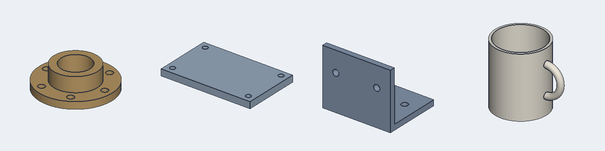

# Text-to-CAD: an Agent Skills workshop

Turn *"a pipe flange, 120 mm across, six M10 bolt holes"* into a 3D part you can
orbit in the browser and export as STL, and learn how to **create**, **apply**
and **evaluate** Agent Skills along the way.



## The workshop

Three hands-on sessions, about 60 minutes each. They run on Claude Code with Sonnet 5
(`claude-sonnet-5`; scripts read `WORKSHOP_MODEL` if you want a different model).

| # | Session | You build | You learn |
|---|---|---|---|
| 0 | [Setup](workshop/00-setup.md) (5 min, before you arrive) | — | How the app fits together |
| 1 | [Create a skill](workshop/01-create-a-skill.md) | `cad-spec`: description to CAD spec | Skill anatomy, progressive disclosure, writing a description that triggers, bundling scripts |
| 2 | [Apply a skill](workshop/02-apply-a-skill.md) | `/text-to-cad`: a self-verifying pipeline, a hook, a batch job | Capability vs workflow skills, test-first agents, verification loops, hooks, headless runs |
| 3 | [Evaluate a skill](workshop/03-evaluate-a-skill.md) | An eval case of your own, and a better skill | With/without-skill benchmarks, deterministic graders, reading transcripts, trigger evals |

Facilitators: see [workshop/facilitator-guide.md](workshop/facilitator-guide.md).

## Quick start

```bash
npm install
npm test        # setup check
npm start       # viewer on http://localhost:3000
claude --model claude-sonnet-5    # in a second terminal
```

## How it works

The model never draws triangles. It writes a small JSON **CAD spec**: primitives
(box, cylinder, cone, sphere, torus) combined with add, subtract and intersect,
plus linear and circular patterns. Code turns the spec into exact geometry. The
same geometry code runs in the browser viewer and in the Node tools, so what the
evals measure is exactly what you see.

```
prompt ─▶ Claude + skills ─▶ app/models/part.json ─▶ viewer (three.js + three-bvh-csg)
                │
                └─▶ validate · measure · check · render   (deterministic tools)
```

## Repo map

```
app/
  SPEC_FORMAT.md       the CAD spec contract (what the skill teaches)
  server.mjs           zero-dependency local server
  public/index.html    viewer: live reload, size/volume HUD, wireframe, STL export
  lib/build.mjs        spec -> CSG solid (browser + Node)
  lib/validate.mjs     structural validator (also bundled into the skill)
  models/              the viewer shows every *.json in here
tools/
  measure.mjs          exact size and volume of the built solid
  check.mjs            acceptance checks: size, volume, ray-cast holes, ...
  render.mjs           two-view PNG render, no browser or GPU needed
  hooks/validate-model.mjs   PostToolUse hook (Session 2)
  claude.mjs           runs `claude -p` headlessly
pipeline/              batch text-to-CAD (Session 2)
evals/                 evals.json, trigger-evals.json, runner, grader, viewer (Session 3)
solutions/             reference skills, if you fall behind
examples/              hand-written example parts
workshop/              session handouts
```

## Commands

| Command | Purpose |
|---|---|
| `npm start` | Viewer at http://localhost:3000 |
| `npm test` | Self-test the setup |
| `npm run measure -- <model.json>` | Exact size and volume |
| `npm run check -- <model.json> <checks.json>` | Run acceptance checks |
| `npm run render -- <model.json> [out.png]` | Render to PNG |
| `npm run batch` | Run `/text-to-cad` on every line of `pipeline/prompts.txt` |
| `npm run eval` | Benchmark the skill: with vs without, graded |
| `npm run grade -- <iteration dir>` | Re-grade existing runs |
| `npm run eval:view` | skill-creator's review and benchmark viewer |
| `npm run reset` | Back to the workshop starting state (facilitators) |
